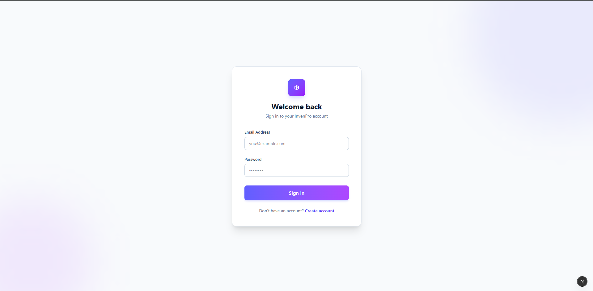
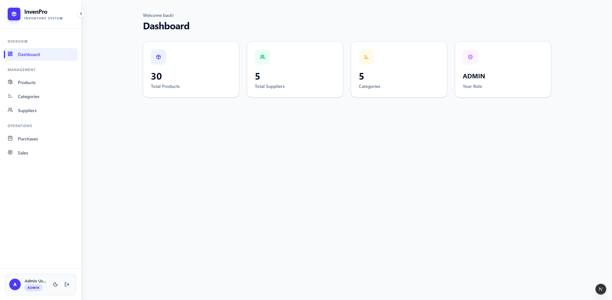
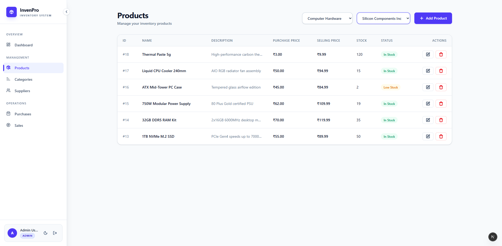
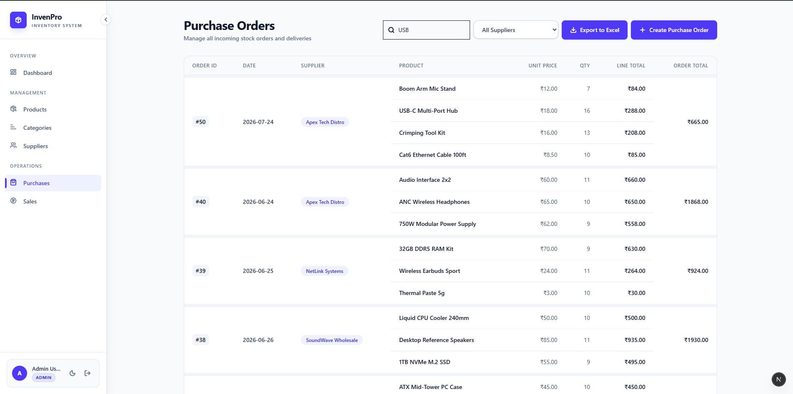
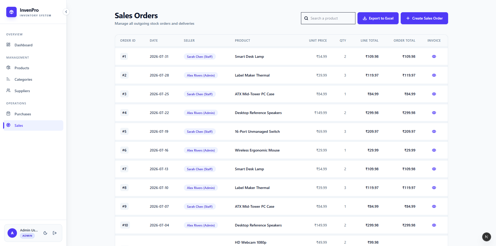
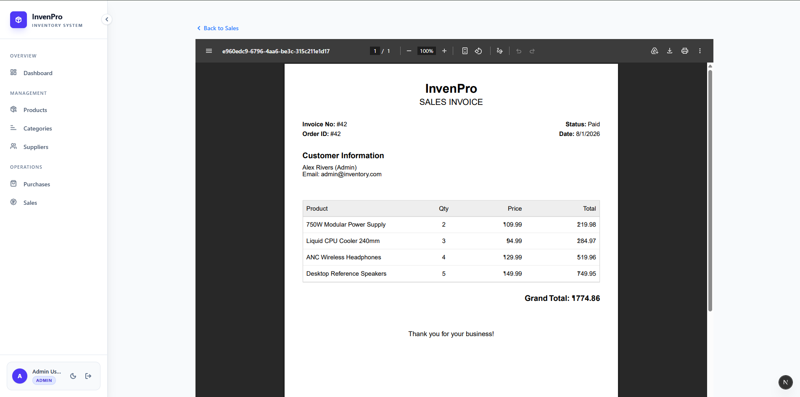

# Inventory Management System

A modern Inventory Management System built with **Next.js**, **TypeScript**, **Drizzle ORM**, and **PostgreSQL**.

This project allows businesses to manage products, suppliers, purchase orders, sales orders, inventory, and invoices through a clean and responsive dashboard.

---

## Screenshots

## Authentication


---

## Dashboard

---


## Product Management

---


## Purchase Orders

---


## Sales Orders

---


## Invoice Generation


---

## Features

### Authentication & Authorization

- JWT Authentication
- Role-Based Access Control (Admin / Staff)
- Secure HTTP-only Cookie Sessions

---

### Product Management

- Create, Edit and Delete Products
- Product Categories
- Supplier Management
- Minimum Stock Tracking
- Inventory Quantity Management

---

### Purchase Management

- Create Purchase Orders
- Multiple Products per Order
- Purchase History
- Supplier Filter
- Search Purchases
- Cursor-based Infinite Scroll Pagination
- Excel Export

---

### Sales Management

- Create Sales Orders
- Multiple Products per Sale
- Seller Tracking
- Invoice Generation
- Search Sales
- Cursor-based Infinite Scroll Pagination

---

### Dashboard

- Inventory Overview
- Stock Information
- Order Statistics

---

### User Experience

- Responsive Design
- Dark Mode
- Toast Notifications
- Loading Skeletons
- Form Validation using Zod
- Reusable Components

---

## Tech Stack

### Frontend

- Next.js 16
- React
- TypeScript
- Tailwind CSS

### Backend

- Next.js Server Actions
- API Routes

### Database

- PostgreSQL
- Drizzle ORM

### Authentication

- JWT
- HTTP-only 
- Sessions in database

### Validation

- Zod

### File Export

- xlsx
- react-pdf

---

## Database Design

Tables

- Users
- Sessions
- Categories
- Suppliers
- Products
- Purchase Orders
- Purchase Order Items
- Sales Orders
- Sales Order Items

---

## Project Structure

```
src/
 ├── app/
 ├── actions/
 ├── components/
 ├── db/
 ├── lib/
 ├── types/
 └── utils/
```

---

## Installation

Clone the repository

```bash
git clone https://github.com/MJ-Enacton/inventory-management-system.git
```

Install dependencies

```bash
npm install
```

Create `.env`

```env
DATABASE_URL=your_database_url
JWT_SECRET=your_secret
```

Run migrations

```bash
npm run db:migrate
```

Seed database

```bash
npm run db:seed
```

Run the development server

```bash
npm run dev
```

---

## What I Learned

- Building a complete inventory workflow
- Database normalization
- One-to-Many relationships
- Cursor-based pagination
- JWT Authentication
- Role-Based Authorization
- Drizzle ORM
- PostgreSQL
- Server Actions
- Infinite Scrolling
- Excel Export
- Invoice Generation
- Reusable component architecture

---

## License

MIT